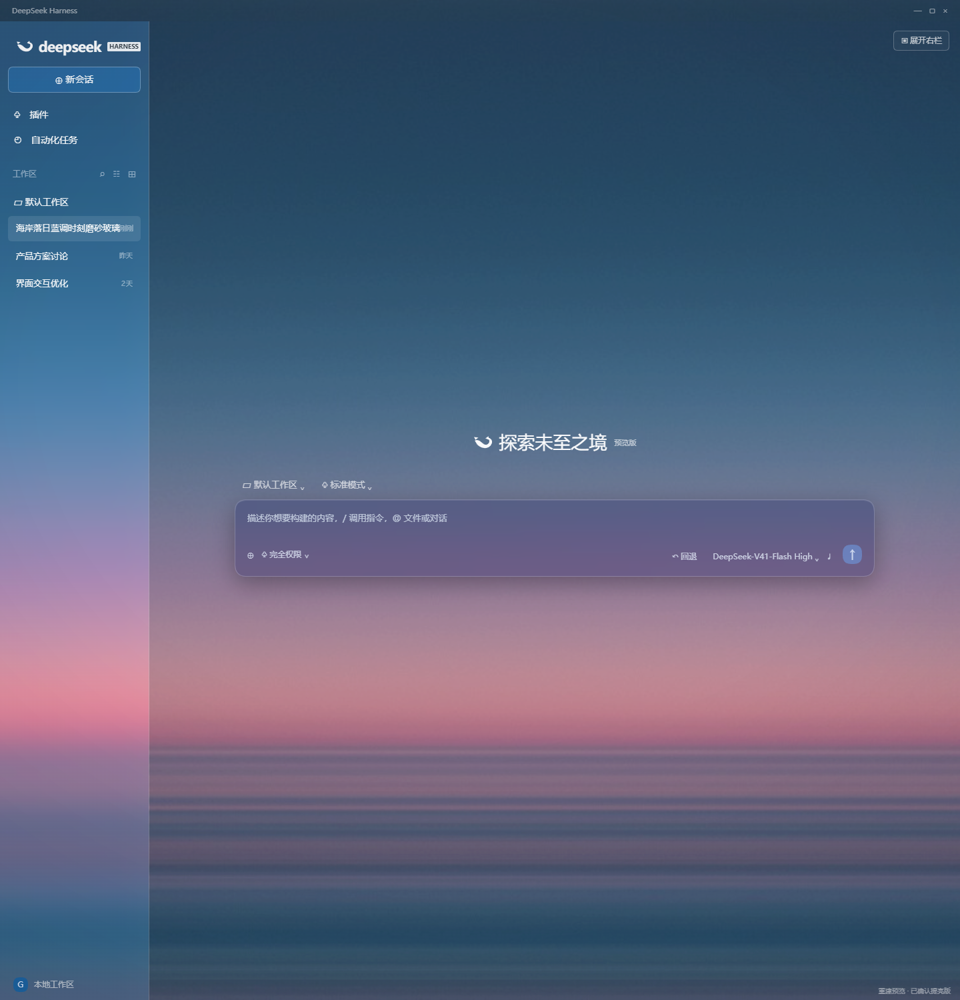
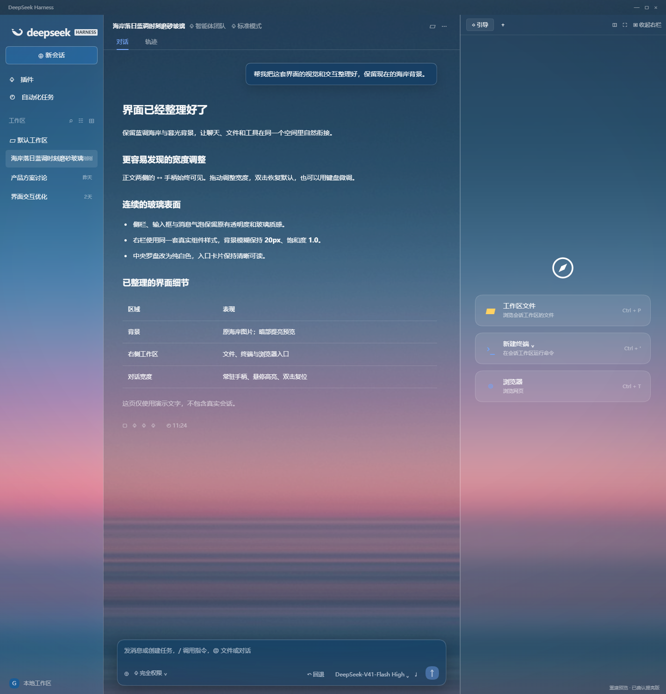
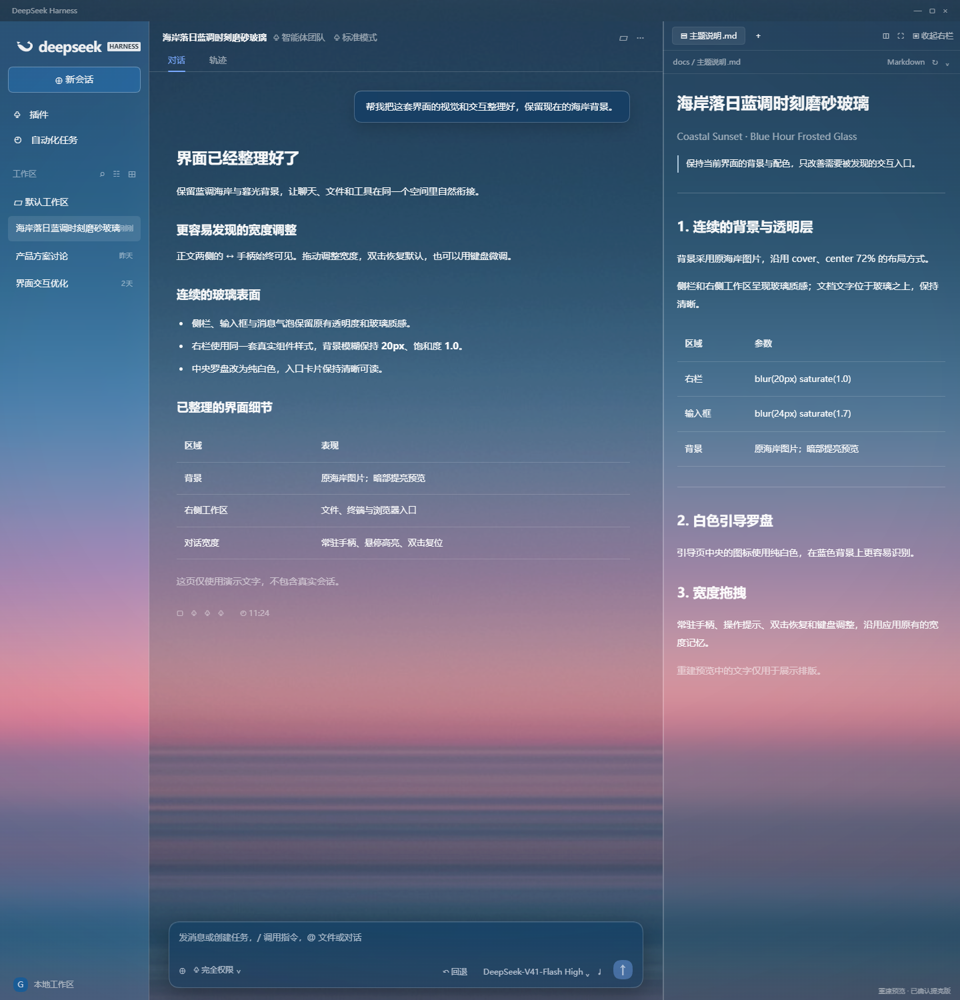

# 海岸落日蓝调时刻磨砂玻璃 / Coastal Sunset · Blue Hour Frosted Glass

DeepSeek Harness 的完整外观与交互主题：蓝调海岸背景、透明玻璃表面、白色引导罗盘，以及始终可见的对话宽度拖拽手柄。







[完整六图图集](docs/color-review/gallery.html)

新版采用与本机一致的原背景和实际组件样式。布局及展示文字为重建，图片不是桌面应用实拍。可打开 `preview/index.html` 切换首页、右栏引导及文档视图；默认采用维护者确认的提亮版：减轻暗角并抬高背景暗部亮度，右栏保持 1.0 饱和度和 20px 模糊。预览直接加载安装包同源的 client.js，不再额外叠加预览专用亮度样式。

这是一款非官方主题插件。只提供视觉样式与宽度控件增强，不修改模型、提示词、工具权限或会话内容。

## 特点

- 保留蓝色海岸、粉色暮光背景，统一侧栏、输入框、用户消息与设置界面的透明层和细边框。
- 右侧引导页中央的罗盘改为白色，修复深灰图标融进蓝色背景的问题。
- 对话两侧常驻 18 × 52px 的「↔」胶囊手柄；可用空间充足时，鼠标命中区为 24px。
- 鼠标悬停高亮并显示操作提示；拖动使用 Harness 原有逻辑和宽度记忆。
- 双击手柄恢复自动宽度；Tab 聚焦，左右键微调，Shift + 左右键快速调整，Home / Enter 复位。
- 停用时移除主题样式、监听器和主题添加的 DOM 属性；保留用户主动调整的宽度偏好。
- 背景随包内嵌，无 CDN、追踪代码或远程素材请求。

## 兼容范围

针对 DeepSeek Harness **0.2.0-rc.2** 的 Web 界面及使用该 Web 界面的桌面端制作。它包含依赖当前 DOM 类名的透明样式，其他版本需要另行验证，不能保证直接兼容。

已经在隔离 Edge 浏览器中，结合目标版本真实 CSS、宽度计算和事件函数验证交互与卸载。测试使用简化的 React 挂载适配器，不等同于完整桌面应用集成测试。测试记录见 [verification.json](docs/verification.json)。本仓库的预览使用模拟内容，不包含真实会话。

## 安装

从 [GitHub Releases](https://github.com/lluck2911-hash/dsh-blue-hour-glass/releases) 下载 `dsh-blue-hour-glass-0.1.3.tgz`。不要解压，然后根据运行方式选择命令：

```powershell
# Web 配置
dsh plugin --profile web add -w ./dsh-blue-hour-glass-0.1.3.tgz

# Windows 官方桌面端：使用源码包内的安装脚本调用桌面运行时
& ./scripts/install.ps1 -Profile desktop -PackagePath ./dsh-blue-hour-glass-0.1.3.tgz
```

命令依赖可用的 dsh CLI 与包管理器。在 Windows 电脑上，可用 [安装脚本](scripts/install.ps1)：

```powershell
& ./scripts/install.ps1 -Profile desktop -PackagePath ./dist/dsh-blue-hour-glass-0.1.3.tgz
```

完成后保存工作、等待后台任务结束，完全退出并重新打开 Harness。启用前停用其他会覆盖全局配色的主题；同一时间保留一套全局主题。

如果通过目录源码安装，请先执行 `node scripts/build.mjs`。普通 CLI 用于 web 配置；desktop 配置由桌面程序管理，应通过桌面内置的 CLI 执行。

## 卸载

```powershell
dsh plugin --profile web remove dsh-blue-hour-glass
# 桌面端请在插件管理界面停用或移除本主题。
```

也可在 Harness 的插件管理界面停用或移除。保存工作并重启后，恢复底层应用样式。该包无需修改或恢复 Harness 安装目录中的核心模块。

## 可选搭配

原界面里的鲸鱼娘桌宠是独立项目 [dsh-whale-musume](https://github.com/Sutera-Diffusus/dsh-whale-musume)，可单独安装。本主题不捆绑桌宠、音乐播放条或任何第三方模型插件，避免重复安装和混淆素材授权。

## 开发和打包

不需要 npm 安装依赖，也没有安装时执行的生命周期脚本。

```sh
node scripts/build.mjs
node --test tests/package.test.mjs
python scripts/pack.py
```

`src/theme.css` 是基础透明样式，`src/lighting.css` 定义已确认的提亮参数；`src/interactions.css` 定义白色罗盘与手柄；`src/mount-theme.js` 管理事件和卸载清理。构建脚本将背景和样式内嵌到 `client.js`，其模块加载形态与 Harness 的浏览器模块表一致。

`dist/` 输出安装包、源码 ZIP 和 SHA-256 校验清单。GitHub 标签发布工作流已准备好，具体步骤见 [PUBLISHING.md](PUBLISHING.md)。压缩包存在不代表已经发布或已被皮肤市场收录。

## 许可与来源

代码采用 MIT，见 [LICENSE](LICENSE)。现有海岸背景从项目维护者提供的本地主题提取；来源说明见 [THIRD_PARTY_NOTICES.md](THIRD_PARTY_NOTICES.md)。维护者已于 2026-10-20 明确确认原背景可随开源主题公开分发，0.1.3 已恢复原海岸图片，不再默认使用替代 SVG。
